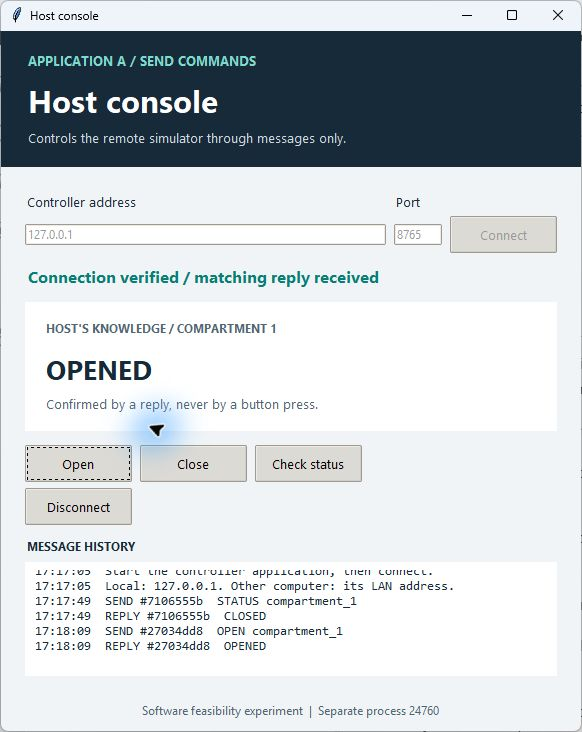
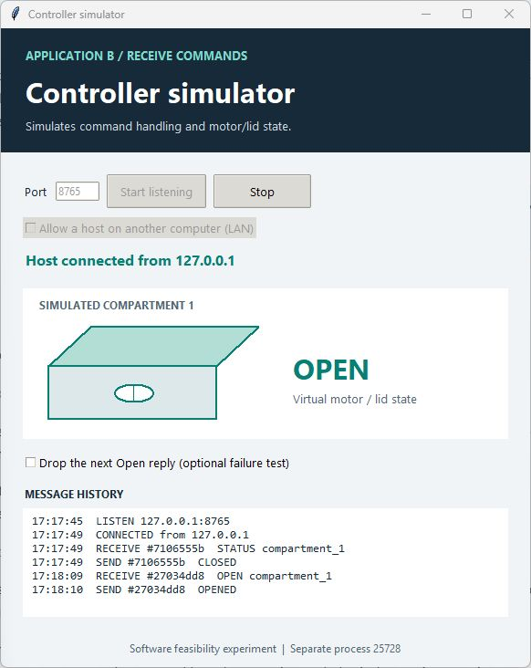
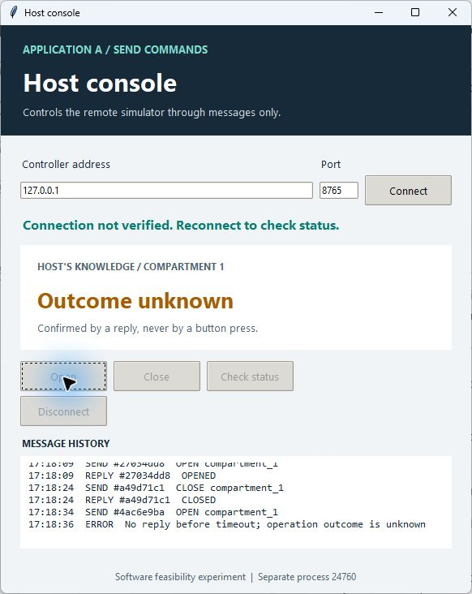
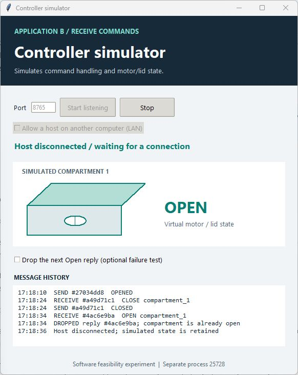

# Recorded feasibility result

Date: October 28, 2026 (America/Toronto).

Original CLI baseline source commit: `2a52e79b5bd32f264e77e0e4319cd38c47cee142`, with a clean working tree before that run. This is historical evidence for the original experiment; later visual applications and server changes are verified separately below.

Starting configuration: Windows, Python 3.12.4, pySerial 3.5 installed into a fresh virtual environment from requirements.txt. The host connected via pySerial's localhost TCP handler to a separate Python simulator process. Each scenario used a fresh simulator; fault cases retained that simulator across reconnects.

Commands:

```powershell
python -m venv .venv
.venv/Scripts/python.exe -m pip install -r requirements.txt
.venv/Scripts/python.exe demo.py --output results/baseline.json
.venv/Scripts/python.exe -m unittest discover -s tests -v
```

Observed result: dependency installed successfully; all six demo scenarios passed; all ten automated tests passed (the integration test runs all six demo scenarios as subtests). See [raw demo evidence](2026-10-28-windows.json) for the environment, exact timestamp, expected/observed results and messages; see [test output](2026-10-28-windows-tests.txt).

Conclusion: this host-side library and proposed message handling run successfully on the tested computer using the simulated byte stream. Deliberate lost, malformed, mismatched and disconnected responses were recognized; the client did not automatically resend an uncertain operation. The simulator's same-process replay cache returned an earlier response without another simulated actuation.

Limits: no board, native serial/USB connection, physical sensor or mechanism was tested. No firmware protocol has been agreed. Replay history and unresolved-operation tracking are in memory; durable recovery and real-device behavior remain untested. These observations do not establish medication dispensing safety or exactly-once physical actuation.

Disposition: retain as a proposed software feasibility experiment for team review; no team approval or adoption is implied. Preparation and execution were assisted by OpenAI Codex. Cross-platform results, when available, are recorded separately in GitHub Actions.

## Visual extension, October 28

Python source revision: `9b2a71e424c3e5a05072a172ba86f517e3ee8860`. The updated simulator retains the existing protocol and supports explicit LAN listening, stoppable/restartable listening and observable message events. Two independent Tkinter applications provide the host controls and virtual motor/lid display.

All six CLI scenarios and all 17 automated tests passed locally with the extended implementation. See [updated demo report](2026-10-28-visual-windows.json) and [17-test output](2026-10-28-visual-tests.txt). The report records its exact source revision and working-tree state; source code was unchanged during the recorded run.

Manual Windows verification used the actual application controls:

- Started the controller's localhost listener and connected from the independent host application. Matching STATUS request/reply `7106555b` reported CLOSED.
- Pressed Open: request/reply `27034dd8` reported OPENED; the controller graphic showed the open compartment. Pressed Close: `a49d71c1` reported CLOSED.
- Armed one dropped Open acknowledgment: command `4ac6e9ba` changed the controller graphic to OPEN, while the host timed out, showed Outcome unknown and disabled mutation controls.
- Reconnected: STATUS `b2a34554` returned OPENED without another OPEN command. The host confirmed the existing state.

The screenshots below are captures of actual separate application windows, not mockups. Both use localhost in this recorded run. The optional LAN bind was also exercised by an automated local connection; no physical second computer was available, so a cross-computer network result is not claimed.

| Host console | Controller simulator |
| --- | --- |
|  |  |
|  |  |
